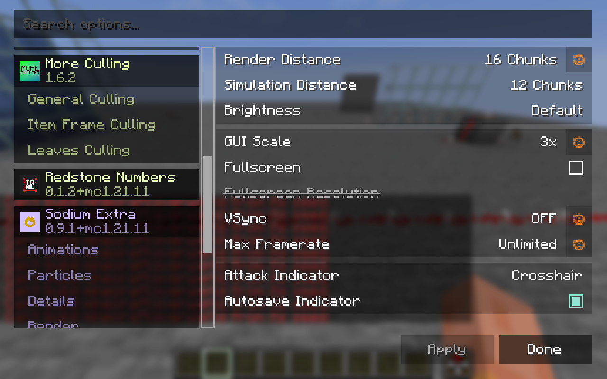
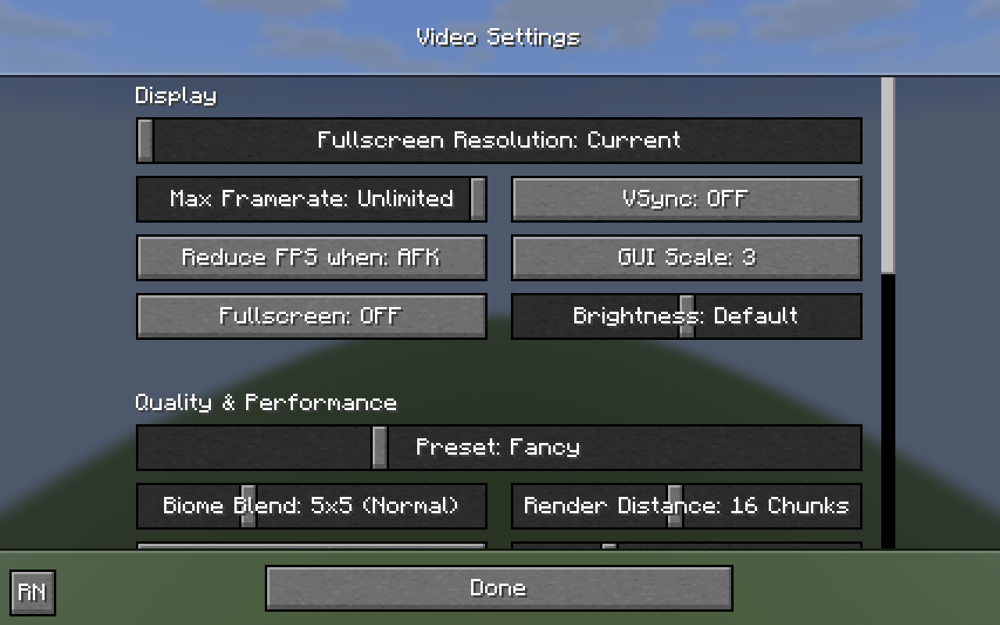
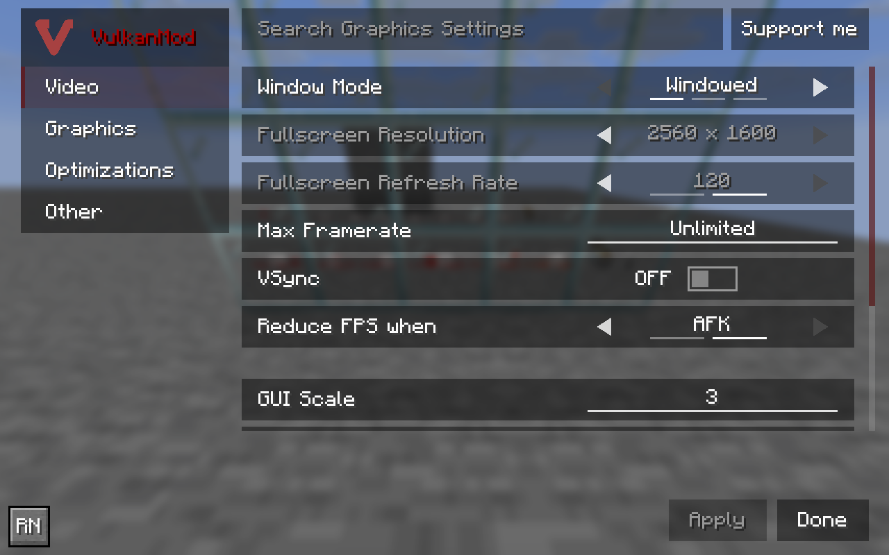
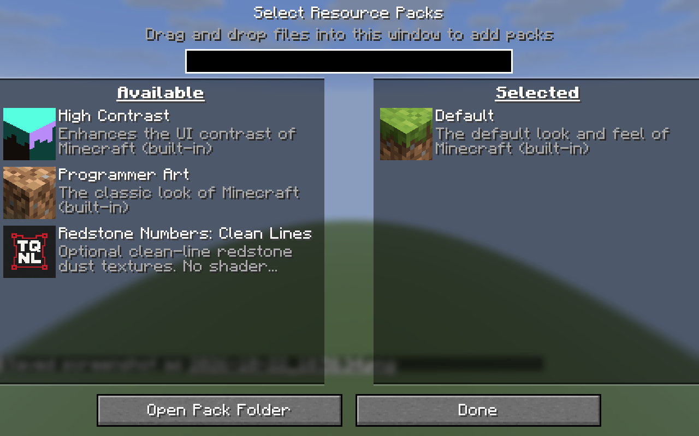

# 0.1.2 for Minecraft 1.21.11

## Video settings

Sodium registers Redstone Numbers through its supported optional config API.
There is one external page opening the existing native settings form. Reese's
Sodium Options collapses that into a compact icon/name/version tab, matching
its other small mod entries. Other Sodium layouts may show an Options row.
No required Sodium or Mod Menu dependency is added; API classes stay compile-only.

The implementation follows the supplied [Sodium usage guide](https://github.com/CaffeineMC/sodium/blob/dev/common/src/api/java/net/caffeinemc/mods/sodium/api/config/USAGE.md),
compiled against the [matching 0.8.12 source/API](https://github.com/CaffeineMC/sodium/blob/mc1.21.11-0.8.12/common/src/api/java/net/caffeinemc/mods/sodium/api/config/USAGE.md).
Current Sodium retains the full-colour icon. Older APIs lacking the non-tinted
icon method fall back to their original tinted icon method; that branch is
source-checked, not runtime-qualified.

Vanilla and recognized replacement video screens get a small RN button in an
unoccupied footer/header corner, preferring the lower left. Fabric screen events
handle initialization, drawing and input. Observing an actual Video Settings
button activation supports renamed replacement screens too. The known Sodium
and Reese's screen families use their API entry instead of a duplicate RN button.
No additional mixins or world-rendering hooks are used.

Arbitrary future custom screens cannot be guaranteed: a mod that replaces the
entire Options launcher, omits standard video entry widgets, bypasses Fabric's
screen events, or covers every suitable corner may require a dedicated adapter.
Mod Menu and the assignable settings key remain independent access routes.

## Built-in clean-line pack and icons

**Options > Resource Packs > Redstone Numbers: Clean Lines** is included in the
mod JAR. It starts under Available, disabled by Fabric's NORMAL activation type.
Select it and choose Done to enable; move it back to Available and choose Done
to disable. There is no extra download for the built-in pack.

The three 16px dust textures are byte-identical to the clean lines in the active
installed TQNL packs. Single committed source files produce both the built-in
pack and the optional standalone cosmetic ZIP. No old number models, blockstates,
shaders or unrelated assets are imported. The original TQNL icon is reused
unchanged for the mod, Sodium entry, built-in pack and cosmetic ZIP. Its PNG
contains no descriptive metadata. Existing artwork terms continue to apply.

## Verification

Computer Use checks ran in disposable fixed-seed 1.21.11 worlds, with synthetic
identity and no user worlds or accounts copied:

- Vanilla Fabric / official Java21: the final RN footer button opens settings
  and avoids the native Done control.
- Sodium0.8.12 + Reese's Sodium Options2.2.3 in the copied installed mod stack:
  compact tab and full-colour icon, click opens settings, Cancel restores an OFF
  preview to the original ON value, and returning preserves the sidebar. The
  duplicate generic button was caught and removed. This stack uses Java25 because
  its existing C2ME modules require it.
- VulkanMod0.6.8 / official Java21: final footer button is visible, avoids Support
  and Apply/Done, and opens settings despite its custom rendering/input code.
- Native Resource Packs menu: clean-line pack begins under Available with its
  icon, enabling writes redstonenumbers:clean_lines and completes resource reload;
  disabling writes vanilla-only selection and completes reload.

The final generic footer placement was checked in vanilla and VulkanMod after
Sodium verification. Its source change only reverses the free-space search order;
the Sodium entry, icon and duplicate-button exclusion stay unchanged. No broader
renderer compatibility matrix or performance benchmark was repeated for this
GUI/resource-pack update. The existing VoxySeedGen synthetic-flatworld warning
also occurs in the copied stack and is unrelated to these settings.

Build and strict asset/privacy audit pass; Gradle reports test NO-SOURCE.
Rendering and wire-index source are unchanged from0.1.1. No new performance claim
is made. Final installed-content preservation and owned-process cleanup are
recorded in project notes.

