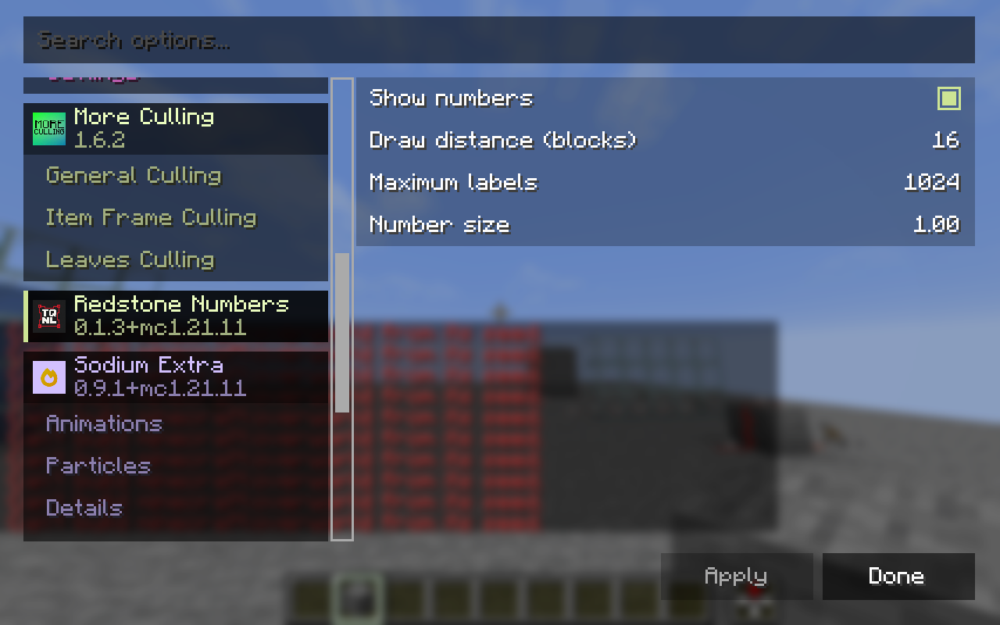
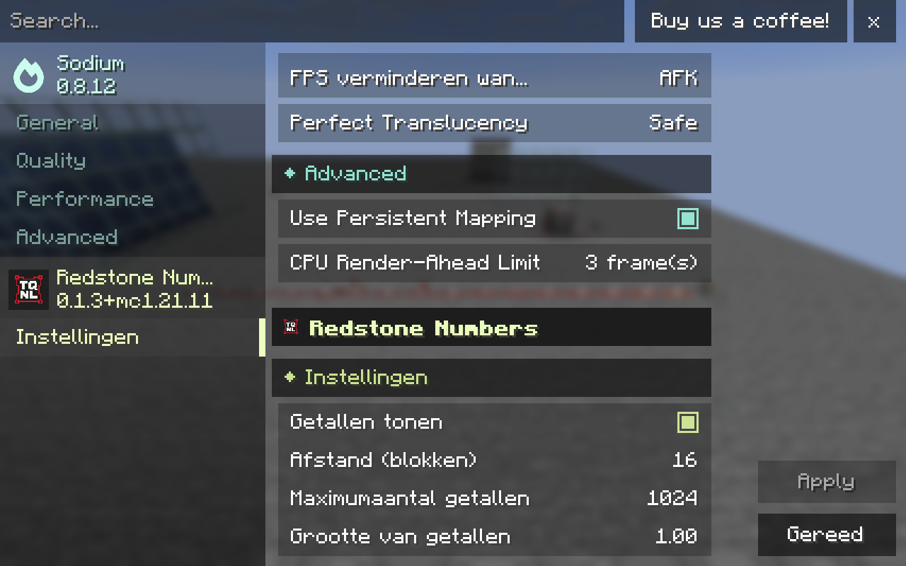
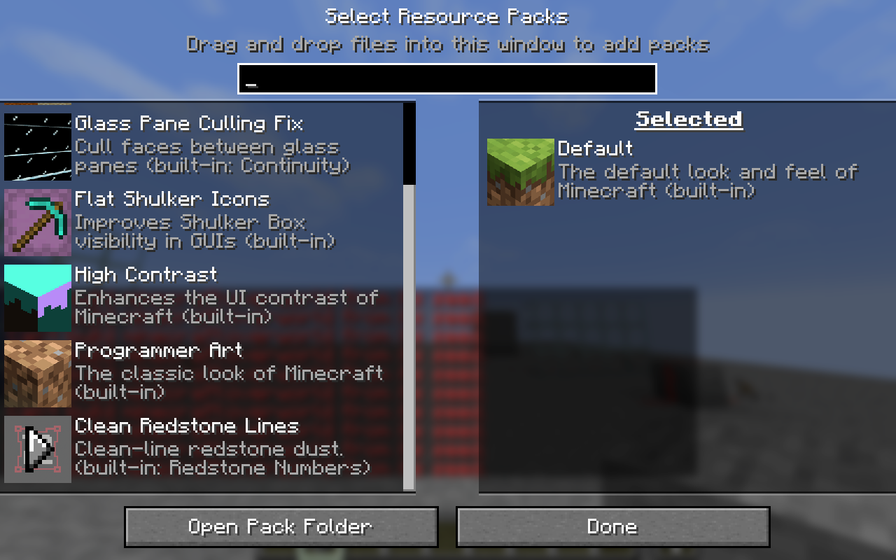
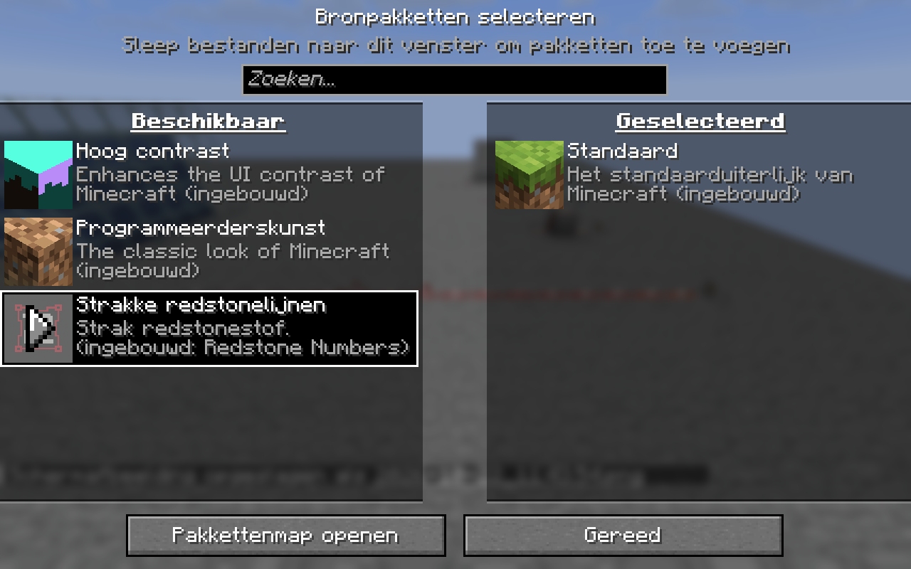

# 0.1.3 for Minecraft 1.21.11

## Native video options

Redstone Numbers now registers one boolean and three integer controls through
Sodium's supported config API, replacing the external-page shortcut. Sodium and
compatible interfaces draw their own checkbox, sliders, help, pending-change
indicators, Apply, Undo and reset controls. Reese's Sodium Options therefore
keeps the same layout and controls as its other settings pages.

The bindings use the existing configuration: enabled, draw distance 1-128,
label limit 1-65536, and size 0.25-4. Size is presented in hundredths. Defaults remain
ON/16/1024/1.0. Valid saved settings are retained; a size with extra decimal places
stays unchanged unless the size control itself is applied.

One shared storage handler flushes changes after the host applies its pending
values. There are no renderer-reload flags, custom Sodium widgets, replacement
Sodium screens, or internal config UI mixins. Sodium stays optional. Vanilla,
Mod Menu and the settings key continue to use the existing standalone form.

API source: [Sodium 0.8.12 config usage](https://github.com/CaffeineMC/sodium/blob/mc1.21.11-0.8.12/common/src/api/java/net/caffeinemc/mods/sodium/api/config/USAGE.md).

## Resource-pack row

The built-in pack is now **Clean Redstone Lines**. Its English and Dutch titles
and extended descriptions fit the native row, including Fabric's built-in source
label. Fabric only creates its extra hover popup when the name is clipped or the
description exceeds two lines. Shorter metadata avoids that popup without any
additional tooltip logic or changing other packs. Custom fonts can affect native
text layout in the same way as for other built-in packs.

The pack remains optional and disabled by default. Its ID, textures and icon are
unchanged, so existing selections are retained. Current product text and packaged
attribution contain no obsolete compatibility references; the release audit now
checks the text in both archives as well as asset/privacy boundaries. Historical
verification documents are retained as records of earlier milestones.

## Verification

Computer Use operated disposable Minecraft 1.21.11 clients with synthetic identity:

- Copied Sodium 0.8.12 / Reese's 2.2.3 stack, Java 25: native checkbox and all three
  sliders appear inside the existing settings pane. Toggling enabled leaves
  saved JSON unchanged until Apply; Undo restores the pending value. Apply saved
  all four controls correctly (OFF,30,10385,1.15).
- Stock Sodium 0.8.12 / official Java 21, without Mod Menu, Dutch language: native
  controls and existing defaults display correctly in Sodium's own layout.
- Resource-pack hover in English with a scrollbar and Dutch without one: full
  title and two-line description, original icon, no clipping popup. Pack remains
  under Available by default. No tooltip hook/mixin was added.
- Build and publication audit pass. Gradle reports test NO-SOURCE. Renderer and
  wire-index bytecode are identical to 0.1.2; no new performance benchmark.

Screenshots below are native F2 captures from the isolated clients. The copied
stack's known VoxySeedGen flatworld warnings are unrelated to this UI update.
Private test configs were restored after clients closed. Final preservation,
process cleanup and artifact hashes are recorded in project notes and the
companion verification JSON.

